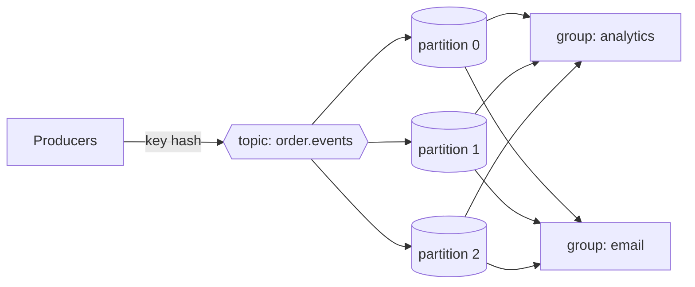

# StreamHive


**A partitioned, durable event log in Go — Kafka's core ideas in one small binary.**

StreamHive lets services publish events to ordered, partitioned, durable topics and consume them in independent consumer groups. It's the decoupling layer for a microservice architecture — `order.created` fans out to inventory, email, and analytics consumers, each tracking its own offset — without operating a full Kafka + ZooKeeper cluster. It runs as a single container on **AWS ECS/Fargate**.

> Why it exists: a growing e-commerce backend needs to decouple services and replay events, but Kafka is operationally heavy and MSK is pricey for a small team. StreamHive gives you the essential log semantics (ordering, partitions, consumer groups, lag) at a fraction of the footprint.

---

## What makes it interesting (engineering)

- **Append-only commit log from scratch** (`internal/commitlog`): length-prefixed records, sequential O(1) appends, an in-memory offset→position index for O(1) reads, and **index reconstruction on startup** so it recovers after a restart.
- **Partitioning by key hash**: messages with the same key always land on the same partition, preserving per-entity ordering — the property that makes event sourcing correct.
- **Consumer groups with independent offsets**: each group resumes exactly where it left off; different groups read the same topic independently.
- **Lag tracking**: the broker reports `end_offset - committed` per group/partition, the key operational metric for streaming systems.
- **Tested** under `-race`: ordering, stable key routing, and independent consumer-group offsets.

## Architecture



Each partition is an independent commit log on disk; each consumer group keeps its own committed offset per partition.

## Quick start

```bash
docker compose up --build
```

Open http://localhost:8082. Click **Publish 30 random** and watch messages distribute across partitions by key. Poll a partition as the `analytics` group and watch the **lag** drop to zero.

## API

| Method | Path | Description |
|--------|------|-------------|
| `POST` | `/api/topics` | `{name, partitions}` — create a topic |
| `POST` | `/api/produce` | `{topic, key, value}` — publish (partition by key hash) |
| `GET`  | `/api/consume?group=&topic=&partition=&max=` | Read from a group's offset |
| `POST` | `/api/commit` | `{group, topic, partition, offset}` — commit an offset |
| `GET`  | `/api/stats` | Topics, partition depths, consumer lag |

## Run locally without Docker

```bash
go build -o streamhive ./cmd/streamhive
./streamhive --http :8082 --data ./data
```

Produce some messages, stop it, restart — the partition logs replay from disk.

## Tests

```bash
go test ./... -race
```

## Development

Common tasks are wrapped in a `Makefile` (`make help` lists everything):

```bash
make check            # lint (vet + gofmt) and run tests with the race detector
make race             # tests under the race detector
make run              # run the service locally
make frontend-dev     # Vite dev server for the React/TS dashboard
make up               # docker compose up --build
```

## Deploying to AWS ECS/Fargate

1. Push the image to ECR.
2. Mount an **EFS volume** at `/data` so partition logs are durable.
3. Expose `:8082` behind an ALB (dashboard + API).
4. This single-broker design is ideal for small/medium event volumes; the commit-log abstraction is the foundation you'd extend toward replication next.

## Project layout

```
cmd/streamhive        entrypoint (+ seeds a demo topic)
internal/commitlog    append-only log with offset index & recovery
internal/broker       topics, partitions, key routing, consumer groups, lag
internal/api          HTTP produce/consume/commit/stats
web/static            live dashboard (Tailwind CDN)
```

## License

MIT
